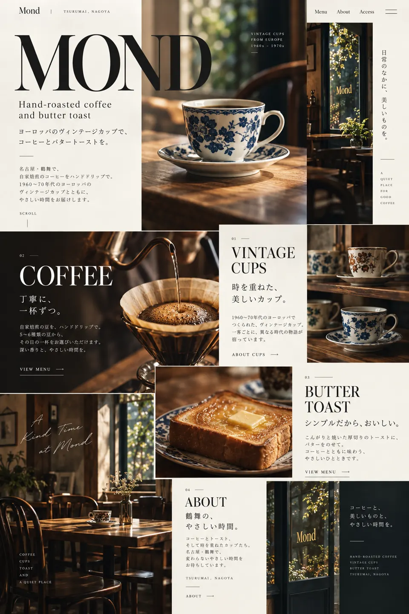

# CP-001 | Mond — The Living Archive

**状態:** チャットで成功例として選ばれた**研究参考案**（クライアント承認・実装承認ではない）。
**題材:** 名古屋・鶴舞の喫茶店を想定した非公式コンセプト。
**主題:** Editorial Triptych Archive / asymmetric editorial collage

## 価値のあるデザイン判断
- 画面を単なる左右2列にせず、**巨大な MOND タイポグラフィ**と異なる幅の写真面で構成する。
- コーヒーカップ、店内、トーストの写真が見出し・テキストと交差し、下の画面にまたがって読ませる。
- 罫線、縦組み、番号、小さな英文、写真の明暗と余白で、整ったグリッドに緊張感を与える。
- 大きな写真をただ積むのではなく、写真のサイズ差とセクション跨ぎを意図して組む。

## 再利用してよい知識と禁止事項
**学習対象:** 編集的な面の配分、サイズ差、文字が骨格となるアートディレクション。
**禁止:** Mond固有のロゴ、写真、コピー、配置比率の丸写し。他店舗のテンプレートにしない。

## 証拠
- オーナーが成功例としてチャットに提示した PNG を、閲覧用 WebP に変換。
- PNG SHA-256: `99316fb40d71a0081bd5e9b892acf69d386a472722fb7d0bb1638ad0a2557d95`
- 登録 WebP SHA-256: `ac8307aaa974aa0b3aabf9b91e9b525533c8119b929bc4e806ff5f56865b6c82`
