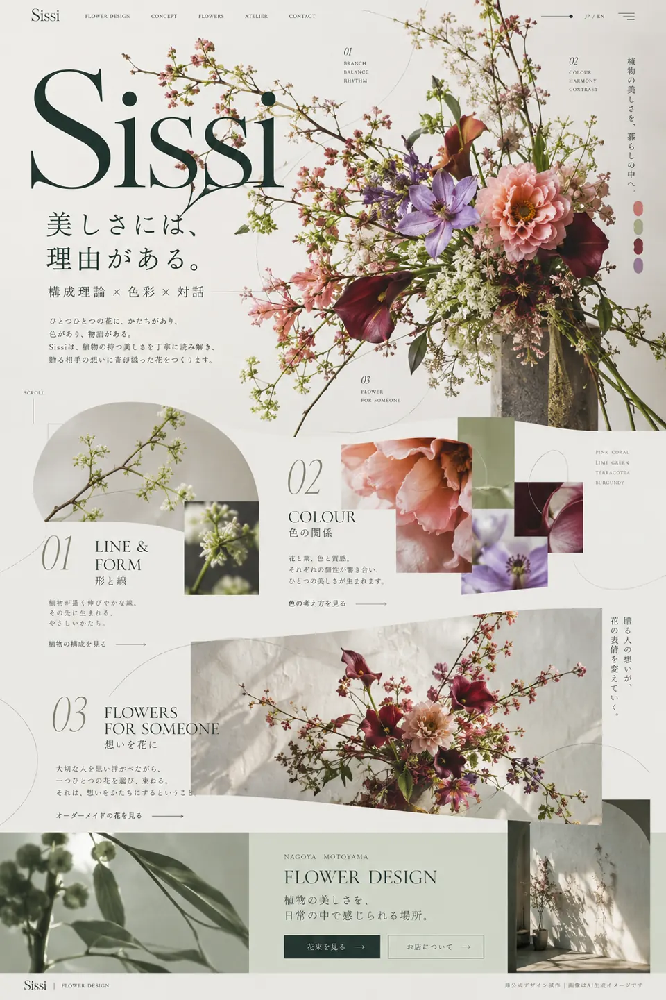

# CP-002 | Sissi — Flower is Art

**状態:** 以前の A/B 比較で A案が明確に支持された**研究参考案**（クライアント承認・実装承認ではない）。
**題材:** フラワーデザイン店を想定した非公式コンセプト。
**主題:** Organic Composition / botanical visual flow

## 価値のあるデザイン判断
- 巨大な **Sissi** の文字と、花・枝の流線が重なり、余白の形や視線の動きを決める。
- 植物写真の切り抜き、大きさの差、円弧・線・縦の小見出しで、画面の複数地点を視覚的につなぐ。
- 商品カードの均等割りではなく、部分的に欠けた写真と断片的な情報をコラージュとして配置。
- 下の章まで植物の構図の運動を引き継ぎつつ、背景と余白に緩急をつける。

## 再利用してよい知識と禁止事項
**学習対象:** モチーフ固有の形態を構図・レイアウトに変換する方法。
**禁止:** Sissi固有のロゴ・写真・文章・枝の配置の丸写し。全店舗に花型の流線を強制しない。

## 証拠
- オーナーが成功例としてチャットに提示した PNG を、閲覧用 WebP に変換。
- PNG SHA-256: `9376f4eb7e24cb881627956d331d9d5f97c405ac197f051128352d0db1b4814d`
- 登録 WebP SHA-256: `07024daaa642e2ea3e28b856119f119a89e352f580c0e14dfbad62e497ea40ef`
