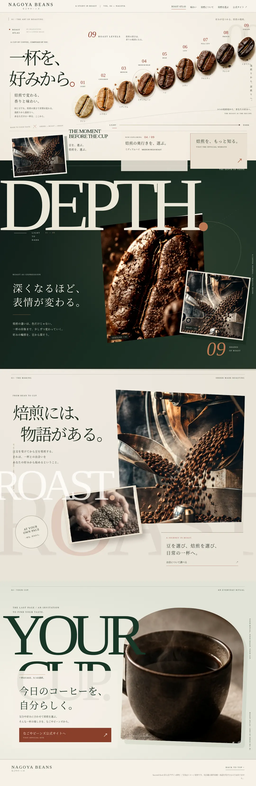

# CP-003 | なごやビーンズ — Editorial Roast Atlas v4

[スマホ版を見る](assets/CP-003_NagoyaBeans_v4_mobile.webp)

**状態:** **DESIGN_APPROVED** / 2026-10-27 JST「これで固定して大丈夫です。」
**対象:** 非公式の研究用WebデザインPoC v4。店舗側の委託・許諾・公開承認を意味しない。
**実装:** HTML/CSS/JavaScriptでのブラウザPoC（Next.jsビルド・公開環境は未検証）。

## 固定されたデザイン判断（本件のみ）
- 最初のA案の「9段階の焙煎マップ」を斜めに構成したHeroを保持。
- 写真・巨大な文字・余白が境界を越えて重なる、エディトリアルな構図。
- **DEPTH / ROAST / YOUR CUP** を異なる視覚的リズムで構成。均等な商品カードの積み上げを避ける。
- PCとスマホは別の構図に調整。選択ボタンやメニューは実Web要素に分離する。
- 実店舗情報（価格、営業時間、商品記述）や生成写真は研究用として扱い、公開前に確認する。

## 研究としての結論
今回の**v4デザインのみ**を固定し、他店のレイアウトには転用しない。
自動制作の成功条件は **画像にある文字・写真・重なり・余白を再現可能な構造として実装し、PC/スマホで検証すること**。ワークフローの本格的な標準化は別レビュー。

## 証拠と元データ
- 元デザインのローカル保管名: `nagoya_beans_editorial_v4_source.zip`
- v4ソースZIP SHA-256: `7f2f14769d196311d22e629097371c67aa2dd1c2b205561b0178279cebe6ff9b`
- PC PNG SHA-256: `c1e42ba20375f2b990f05c43086504fae23fdd9030359d9e9565dda87fa13d24`
- スマホPNG SHA-256: `f8050aaf2b629d805fa338cad0c46edc7d3df2c8a7111f918f645da451169a1b`
- 登録WebP PC SHA-256: `be8f9aaeb06f02d192a08ceaab640eb1121befe14daa59eaee2e4d59e3ee52b6`
- 登録WebP スマホ SHA-256: `45d54a7e3cf774c61c66ddb498e326b07a8bdc8f182e64c38a83a101e12aa7a0`
